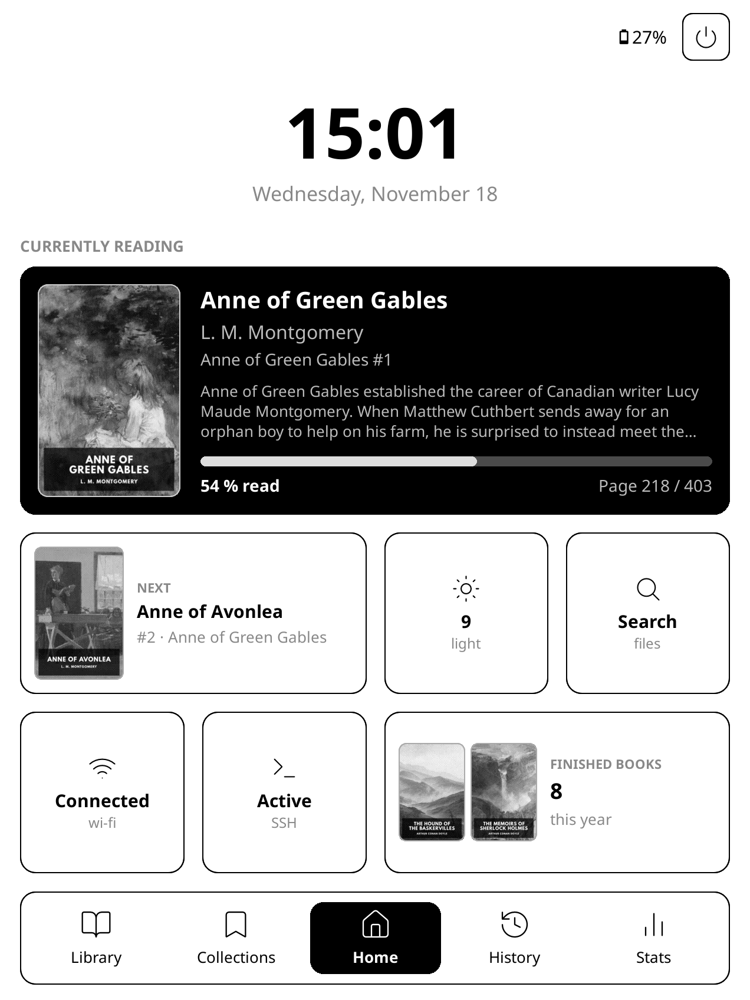
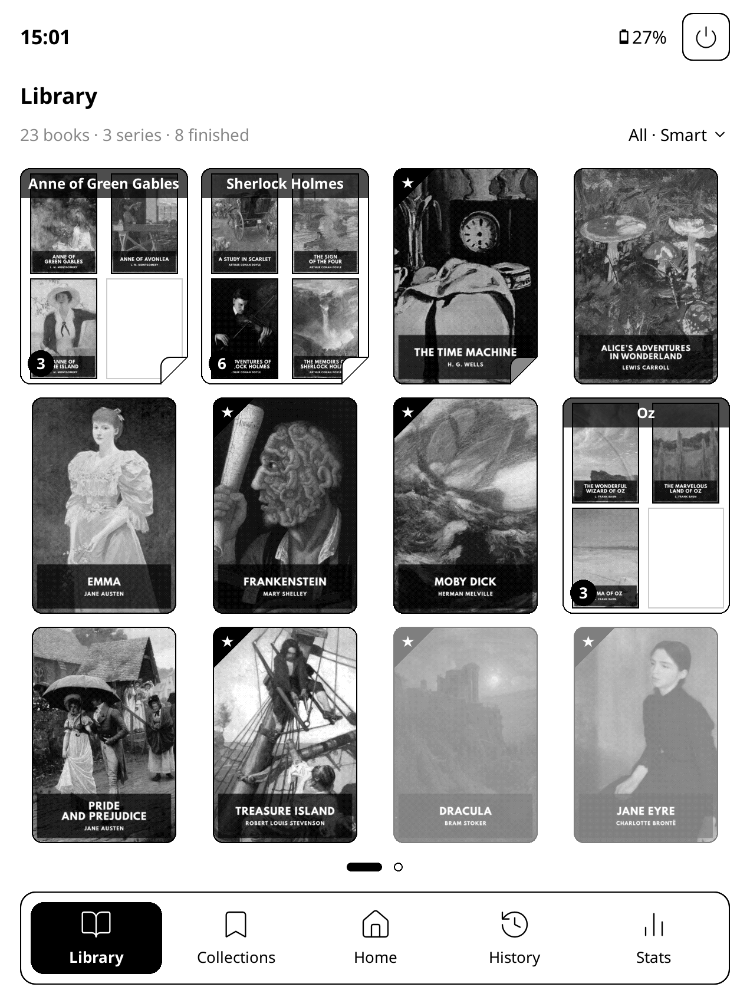
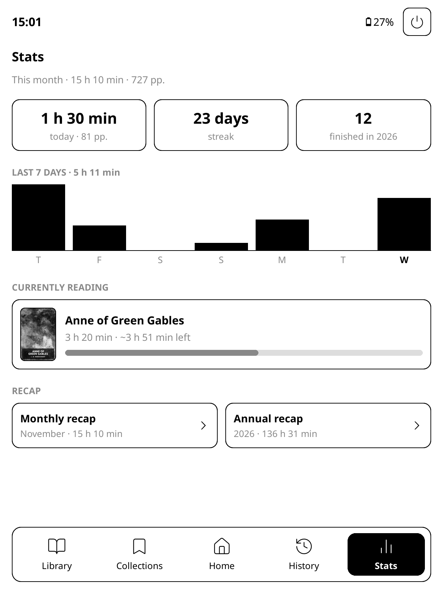
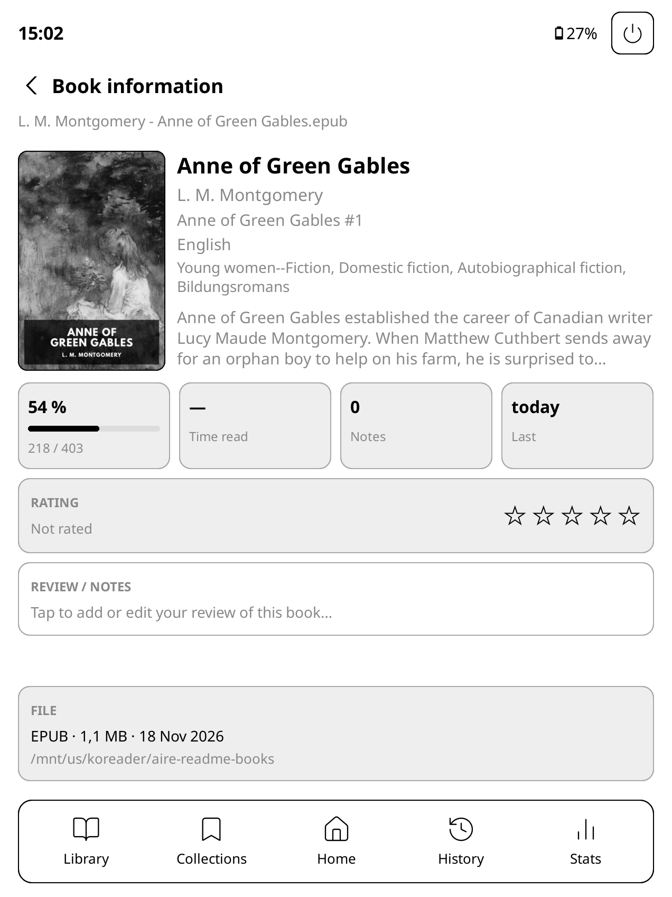
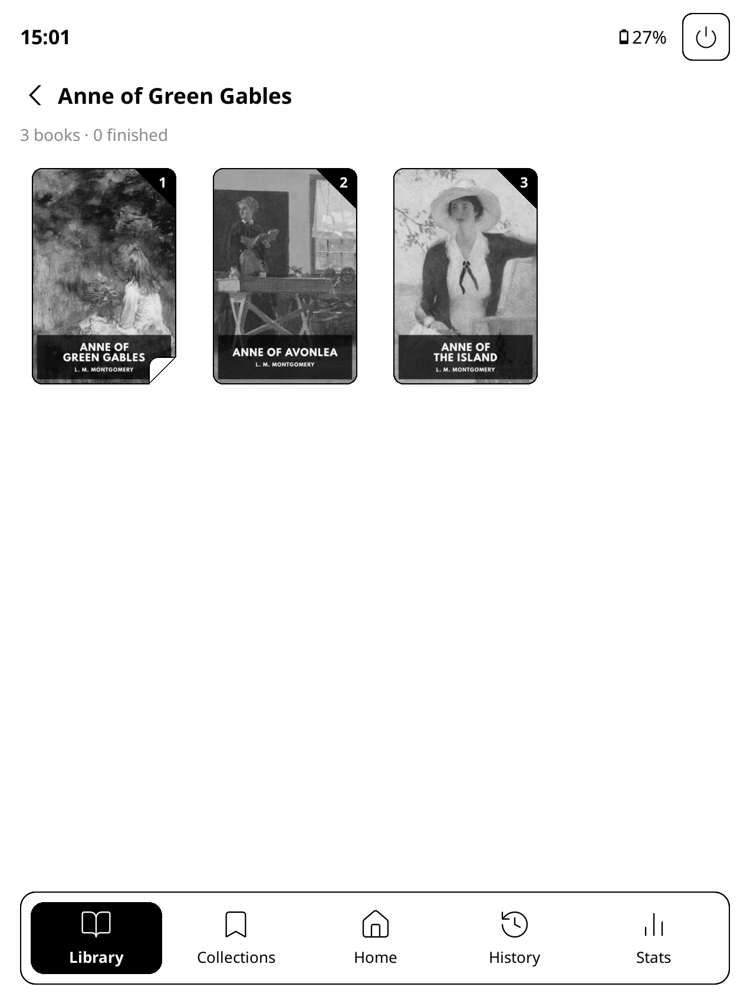
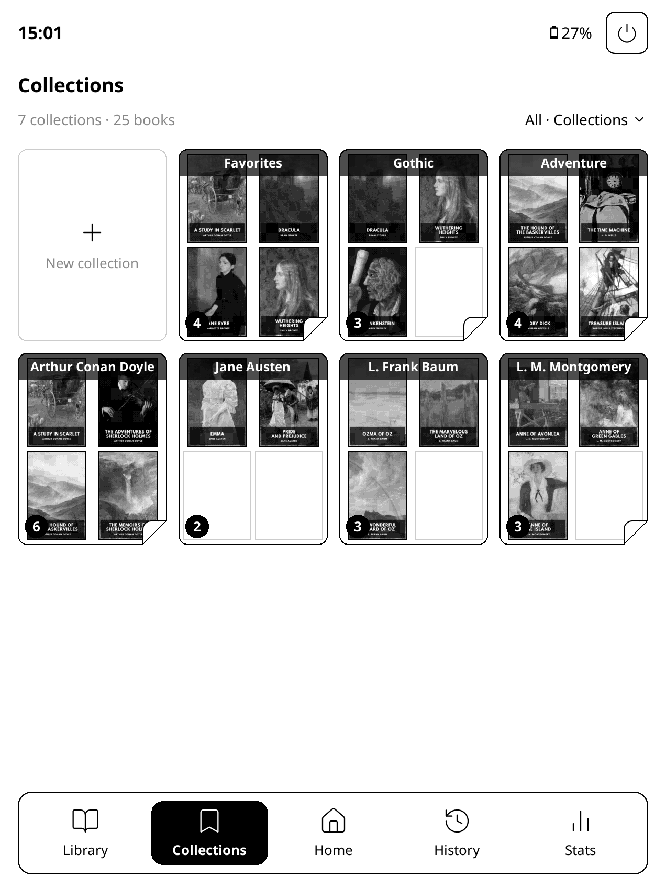
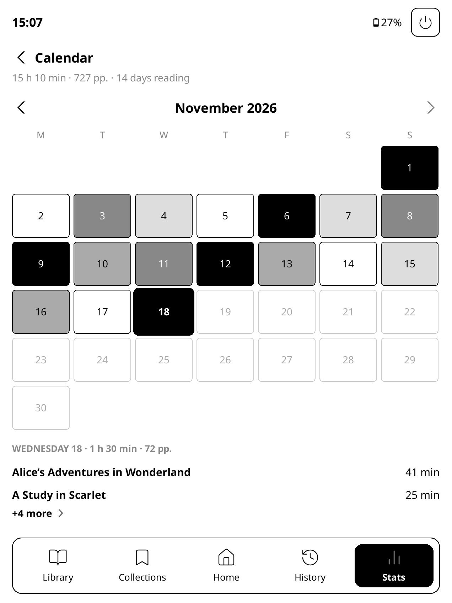
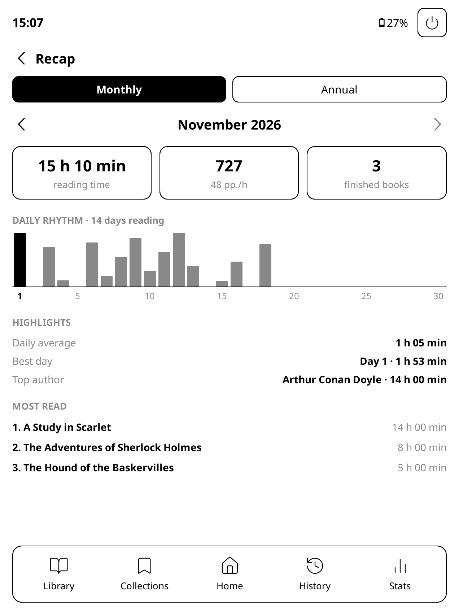
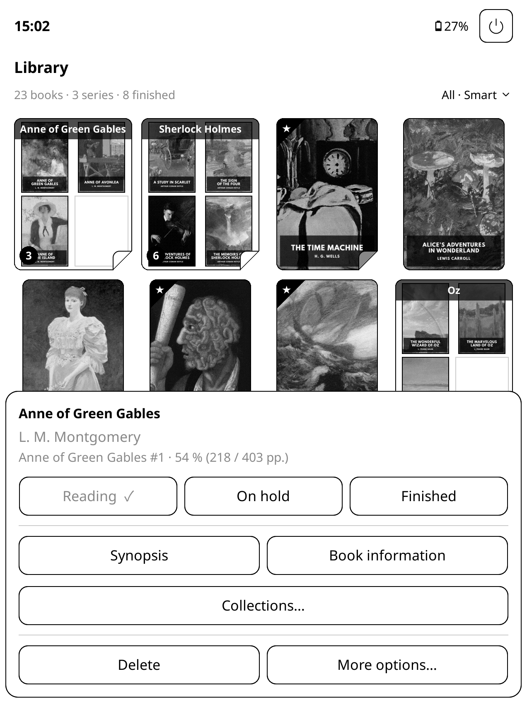
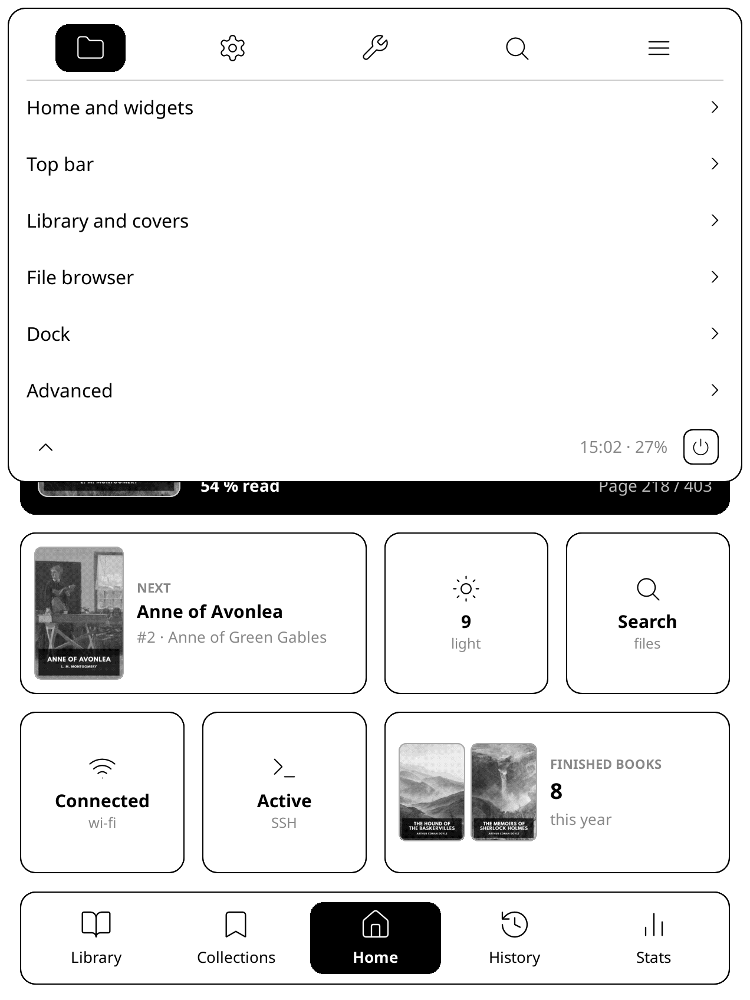

<p align="center">
  <picture>
    <source media="(prefers-color-scheme: dark)" srcset="docs/assets/aire-logo-dark.png">
    
  </picture>
</p>

<p align="center">
  A clean, modern home screen and UI overhaul for <a href="https://koreader.rocks/">KOReader</a>.
</p>

<p align="center">
  
  
  
  
  
</p>

<p align="center">
  
  
  
  
</p>

<details>
<summary>More screenshots</summary>
<p align="center">
  
  
  
  
  
  
  
</p>
</details>

<sub>Screenshots taken on a Kindle Paperwhite with public-domain books from <a href="https://standardebooks.org">Standard Ebooks</a> and sample reading statistics.</sub>

---

## Contents

- [Features](#features)
- [Requirements](#requirements)
- [Installation](#installation)
- [Updating and uninstalling](#updating-and-uninstalling)
- [Integration with official KOReader plugins](#integration-with-official-koreader-plugins)
- [Compatibility with patches and other plugins](#compatibility-with-patches-and-other-plugins)
- [Settings and data](#settings-and-data)
- [Known limitations](#known-limitations)
- [Reporting bugs](#reporting-bugs)
- [Requesting features](#requesting-features)
- [Contributing](#contributing)
- [Localization](#localization)
- [Project structure](#project-structure)
- [Changelog](CHANGELOG.md)
- [License](#license)

## Features

- **Home screen**
  - Top bar with clock, status indicators (memory, Wi-Fi, frontlight, battery) and a power menu (sleep, power off, reboot, restart, exit).
  - Optional large clock and date.
  - **Currently reading** card: cover, title, author, series, progress, optional synopsis; tap to resume, hold for book information.
  - **Home widgets** in a 4-column grid (next in series, previous/random/recent book, quote of the day, today and streak, finished books, Wi-Fi, frontlight, warmth, night mode, battery, storage, reading timer, SSH, shortcuts…). Each widget can be large or small, inverted, and have tap and hold swapped.
- **Own views** (bottom dock)
  - **Library**: cover grid of your home folder with filters (All, Reading, New, Finished), smart/title/author/recent sorting, and series grouped as cover mosaics.
  - **Collections**: KOReader collections as mosaics, collection management, and optional automatic collections by author or genre.
  - **History**: recently read books with status filters and quick removal.
  - **Stats**: today, streak, last 7 days, current book, monthly calendar heatmap, finished books, and a monthly/annual **Recap**.
- **Bottom dock**: Library · Collections · Home · History · Stats. Long-press **Home** to switch between Aire and KOReader's classic file browser.
- **KOReader-wide restyling**: rounded dialogs, bottom sheets for option menus and pickers, dot pagination, SVG checkmarks, capsule progress bars, a cleaner top menu and reader bottom menu, and a book/series action sheet on long-press.
- **Redesigned KOReader screens**: book information, table of contents, bookmarks, search results, book map, page browser, image viewer, book status, folder shortcuts, and screens of official plugins (see [below](#integration-with-official-koreader-plugins)).
- **Bundled icons and translations**: its own `aire.*` SVG icons and 44 languages, with proper plural forms.

## Requirements

| Requirement | Details |
|---|---|
| KOReader | **2026.07 or newer**. Developed and tested on 2026.07.2. Older versions may work but are not supported. |
| Device | Any touch-screen device supported by KOReader. Developed and tested on a **Kindle Paperwhite 6**, portrait orientation. |
| CoverBrowser plugin (official) | **Recommended.** Aire reads book metadata and covers from CoverBrowser's cache. Without it, views still work but show titles from file names and no covers. |
| Statistics plugin (official) | **Recommended.** Needed for the Stats tab, the Recap, the calendar, reading times and the "today/streak" widgets. Without it, those parts show an empty state. |
| Other official plugins | Optional: Reading timer, SSH, Vocabulary builder and Battery statistics enable the matching widgets and restyled screens. |

Aire has **no external dependencies**: it only uses KOReader's own modules and needs no network access.

## Installation

1. Download the latest release (or clone this repository) and make sure the folder is named **`aire.koplugin`**.
2. Copy it into KOReader's `plugins/` folder:
   ```text
   koreader/
   └── plugins/
       └── aire.koplugin/
   ```
   Only `_meta.lua`, `main.lua`, `menu.lua`, `core/`, `ui/`, `views/`, `styles/`, `icons/` and the compiled translations (`l10n/*/aire.mo`) are needed on the device. Release zips contain just that. When working from a clone, `python scripts/kindle_copy.py` makes a clean copy for the device.
3. Restart KOReader.
4. If Aire is not active, enable it in **Tools → More tools → Plugin management**.

Aire's options are at the top of the first tab of the file browser menu: **Home and widgets**, **Top bar**, **Library and covers**, **File browser**, **Dock** and **Advanced**.

## Updating and uninstalling

- **Update**: delete the old `aire.koplugin` folder from the device first, then copy the new one. Copying over the old folder can leave renamed or removed files behind.
- **Uninstall**: disable Aire in Plugin management and restart, or delete the `aire.koplugin` folder. Settings are kept in `settings.reader.lua` under the key `aire`; remove that entry to reset them.

Disabling Aire restores KOReader's original screens after a restart. While Aire is enabled, long-pressing **Home** only switches between Aire's home screen and the classic file browser; the KOReader-wide restyling stays active.

## Integration with official KOReader plugins

Aire does not modify any official plugin files. It adapts some of their screens at runtime and uses their data when they are available:

| Official plugin | What Aire adds or changes | If the plugin is disabled |
|---|---|---|
| **CoverBrowser** | Reads metadata and covers for Library, Collections, History and widgets. Removes CoverBrowser's own indicators in the file browser and applies a 3- or 4-column grid. | No covers; titles from file names. |
| **Statistics** | Stats tab, Recap, calendar heatmap, reading times in book information. Restyles **Reading progress** and the **Calendar**. Deleting stats from Aire's Stats tab writes to `statistics.sqlite3`. | Stats tab and related widgets show an empty state. |
| **Vocabulary builder** | Restyled review screen ("next review" card and a clean list). | Not applicable. |
| **Reading timer** | "Reading timer" widget (start/stop). | Widget not offered. |
| **SSH** | "SSH" widget (toggle server, port). | Widget not offered. |
| **Battery statistics** | Holding the battery widget opens it. | Hold does nothing. |

## Compatibility with patches and other plugins

Aire replaces the file browser's home view and restyles much of KOReader, so some user patches and plugins overlap with it. On startup Aire checks for them (**Advanced → Check patches and plugins on startup**):

- **Community patches that do the same as Aire or conflict with it** (they are renamed to `.disabled`): mainly patches that change covers in the file browser and patches that replace the reader status bar.
- **Plugins that replace the same screens** (they are disabled): other home screen and file browser replacements.

Aire tells you what it disabled and offers to restart. Patches that do not overlap are left alone and are listed as new the first time they appear.

## Settings and data

- All settings live in `settings.reader.lua` under `aire`. Nothing is written to your books or their `.sdr` folders.
- Aire reads CoverBrowser's cache, KOReader's history and collections, and `statistics.sqlite3`. It only writes to them when you ask it to (remove from history or a collection, change a book's status, delete statistics).
- Aire makes **no network connections** and collects no data.

## Known limitations

- **Beta.** Tested on a single device (Kindle Paperwhite 6, portrait). Landscape, small screens and other devices may show layout issues.
- **Translations** other than Spanish were machine-generated using KOReader's own terminology. Corrections from native speakers are very welcome.
- Aire hooks into KOReader internals. A future KOReader version can break parts of it; the affected part logs a warning and the rest keeps working.

## Reporting bugs

Please open an issue with the **Bug report** template. A good report includes:

1. **Aire version** and **KOReader version**. Aire writes its version to `crash.log` at startup (`Aire version 0.2.0`); KOReader's is in Help → About.
2. **Device**, model and **orientation**.
3. **KOReader language**.
4. **Steps to reproduce**: what you tapped, ideally starting from a fresh start.
5. **What happened** and **what you expected**.
6. **`crash.log`**: the lines around the problem (search for `Aire` and `ERROR`). It is in KOReader's folder (`koreader/crash.log`; on Kindle `/mnt/us/koreader/crash.log`). Remove personal paths or book titles if you prefer.
7. **Other user patches and plugins** you have enabled.
8. **Screenshots** if it is a visual problem.

````markdown
**Aire version:**
**KOReader version:**
**Device / model:**
**Orientation:** portrait / landscape
**Language:**

**Steps to reproduce**
1.
2.

**What happened**

**What I expected**

**crash.log (relevant lines)**
```
paste here
```

**Other patches / plugins enabled**

**Screenshots**
````

## Requesting features

Open an issue with the **Feature request** template. Describe the problem you want to solve, your idea, which screen it affects, and the alternatives you considered. Mock-ups or sketches help a lot, since most of Aire is visual.

## Contributing

Contributions are welcome; see **[CONTRIBUTING.md](CONTRIBUTING.md)**. In short:

- **Bugs and ideas**: use the issue templates.
- **Translations**: edit `l10n/<language>/aire.po`, run `python scripts/l10n.py check` and open a pull request. Native-speaker reviews of the machine-generated languages are especially valuable.
- **Code**: keep changes small and focused, test them on a device, and attach the relevant `crash.log` lines to the pull request.
- **Design**: screenshots and mock-ups for new screens or improvements.

## Localization

Aire ships translations for 44 languages. Strings that KOReader already translates are left to KOReader, so Aire never overrides KOReader's own wording.

```bash
python scripts/l10n.py extract   # Extract strings from the Lua files and update the .po files
python scripts/l10n.py check     # Missing translations, placeholders, conflicts with KOReader
python scripts/l10n.py compile   # Compile .po files to .mo
```

## Project structure

```text
aire.koplugin/
├── _meta.lua          # Plugin metadata
├── main.lua           # Entry point: loads everything, plugin class, view switching
├── menu.lua           # Aire's settings menu and clean-up of KOReader's menus
├── core/              # Core helpers: settings, bundled icons, l10n loader, compatibility check, OTA updater
├── ui/                # Shared UI primitives: theme, screen metrics, bottom sheets, card lists, full-screen pages
├── views/             # Aire's own screens: home, topbar, dock, explorer, power (power sheet),
│                      #   update_sheet (OTA UI), booksheet (hold sheets),
│                      #   grid/ (Library, Collections, History: init, data, cells, LRU covers, library cache, thumbnails),
│                      #   stats/ (Stats, Recap: init, data, charts),
│                      #   widgets/ (Home widgets: init, parts, catalog, picker/presets)
├── styles/            # Restyling of KOReader screens grouped by area:
│                      #   reader/ (toc, bookmark, search, skim, highlight, footer, bookmap, pagebrowser),
│                      #   filemanager/ (bookinfo, bookstatus, collections, covers, shortcuts, sortwidget, imageviewer),
│                      #   plugins/ (calendar, gestures, readerprogress, statspages, vocabbuilder),
│                      #   ui/ (KOReader-wide dialogs, menus, sheets… loaded in order by ui/init.lua)
├── icons/             # Bundled SVG icons (aire.*) and their licenses (icons/LICENSE.md)
├── l10n/              # Gettext translation catalogs (.pot and .po sources, compiled .mo)
├── scripts/           # Maintenance scripts (l10n.py, lualint.py, kindle_copy.py)
└── docs/              # Logo and screenshots for this README (not needed on the device)
```

## License

Aire is licensed under the **GNU Affero General Public License v3.0 (AGPL-3.0)**, the same license as KOReader. See [LICENSE](LICENSE).

Most icons are based on [Lucide](https://lucide.dev) (ISC License); see [icons/LICENSE.md](icons/LICENSE.md).

Aire is an independent project and is not affiliated with the KOReader team.
